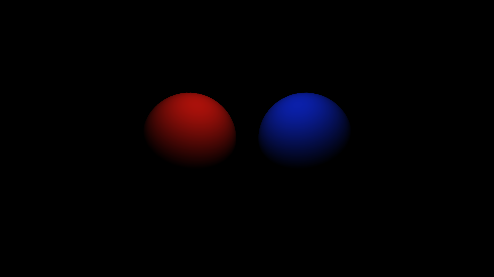
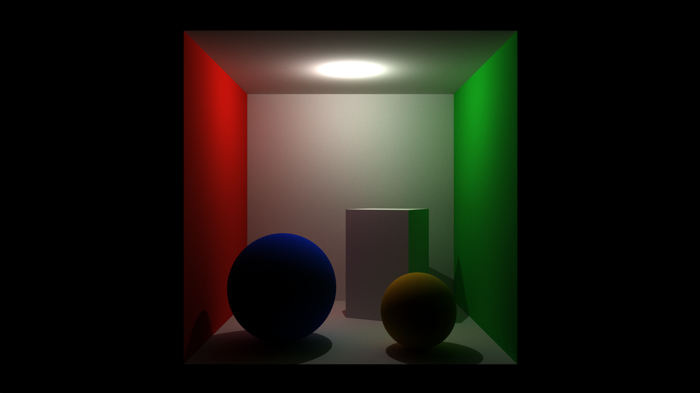

# C++Renderer

A C++17 CPU ray tracer with XML scene loading, Lambert diffuse materials,
direct and indirect lighting, and hard shadows. Rendering runs across multiple CPU threads,
and MiniFB displays the pixel buffer.

## Features

- Perspective camera with floating-point pixel coordinates.
- Sphere, triangle and disk primitives with closest-hit ray intersections.
- Scene objects with translation, Euler rotation and positive uniform scaling.
- Directional, point and spot lights; distance attenuation for point and spot
  lights and cone falloff for spotlights.
- Shared, named Lambert materials with a diffuse BRDF of `albedo / pi`.
- Direct illumination with cosine weighting and shadow-ray visibility tests.
- Recursive indirect lighting with configurable depth limits and Russian roulette termination.
- Jittered supersampling antialiasing with configurable samples per pixel.
- XML scene validation and automated scene loader tests.

Dependencies are included in the repository: GLM 1.0.3 (header-only mathematics),
MiniFB 0.10.1 (window and pixel-buffer display), and TinyXML-2 11.0.0 (XML parsing).
The build requires CMake 3.16 or newer and a C++17 compiler.

## Render examples

### Two Lambert spheres



Scene: [scene/Scene02.xml](scene/Scene02.xml). Two spheres with red and blue
Lambert materials under a single point light, showing diffuse shading against
a black background.

### Cornell Box



Scene: [scene/CornellBox.xml](scene/CornellBox.xml). An open-front room with red
and green walls, two colored spheres and a rotated box. A point light near the
ceiling illuminates the scene, showing hard shadows and indirect color bleeding.

## Building on Windows

Install CMake and a MinGW toolchain, and ensure that `cmake`, `gcc`, `g++`, and
`mingw32-make` are available in your `PATH`. The Windows helper uses the
`MinGW Makefiles` generator. Run from the project directory:

```powershell
.\build.bat
```

Run the generated executable from the project directory:

```powershell
.\build\C++Renderer.exe
```

For a manual build with the same generator:

```powershell
cmake -S . -B build -G "MinGW Makefiles" -DCMAKE_BUILD_TYPE=Debug
cmake --build build
```

## Building on Linux or macOS

Install CMake, a C/C++ compiler, and the platform development libraries required
by MiniFB. From the project directory:

```sh
sh build.sh
./build/C++Renderer
```

## Running and configuration

The application entry point is `source/main.cpp`. It currently creates:

```cpp
Renderer renderer(1920, 1080, 3, 15, 1000, "scene/CornellBox.xml");
```

Change this call and rebuild to select another scene or resolution. There are
currently no command-line options. The arguments specify width, height, minimum
depth for Russian roulette, maximum recursion depth, samples per pixel and the
scene path. This example uses 1000 jittered samples per pixel, starts Russian
roulette at depth 3 and sets the maximum depth to 15.

Run from the project directory or the build directory so relative scene paths
resolve correctly. CMake copies all three scene XML files into `build/scene`
and refreshes them on subsequent builds after edits. For Visual Studio
configurations, use the build directory as the working directory rather than
its Debug/Release subdirectory.

## Code structure

| Component | Responsibility |
| --- | --- |
| `Camera` | Generate perspective rays for subpixel positions. |
| `Ray` / `Intersection` | Store ray intervals and hit distance, position and normal. |
| `Primitive` | Define the intersection interface for `Sphere`, `Triangle` and `Disk`. |
| `SceneObject` | Own primitives, store object transforms and reference a material. |
| `Scene` | Own objects, lights and named materials, store the camera and find the closest hit. |
| `Light` | Evaluate directional, point and spot light contributions. |
| `Material` | Evaluate surface BRDFs; currently implemented by `LambertMaterial`. |
| `Renderer` | Trace camera, shadow and indirect rays, evaluate lighting and display pixels. |
| `source/SceneLoader.cpp` | Parse and validate XML scenes through `Scene::LoadSceneFromXML`. |

At each visible surface, the renderer sums unoccluded light contributions
weighted by the material BRDF and the clamped normal/light cosine. Missed rays
return black. Hemisphere sampling and recursive rays add indirect lighting,
including color bleeding in CornellBox. Russian roulette limits path lengths
after the configured minimum depth, with a hard maximum recursion depth.

## XML scenes

`Scene::LoadSceneFromXML(filepath, width, height)` returns a scene owned by the
caller. `Renderer` loads the scene in its constructor and deletes it in its
destructor.

| Scene | Contents |
| --- | --- |
| `scene/CornellBox.xml` | Default scene: five inward-facing walls, two spheres, a rotated triangle-based box, colored Lambert materials and one point light. |
| `scene/Scene02.xml` | Two separated spheres with red and blue Lambert materials and one point light. |
| `scene/Scene01.xml` | Legacy geometry fixture with a camera, a two-triangle square and a sphere; no lights or materials. |

Assign a material to every object used for rendering. Although the loader
accepts objects without a material, the active shading path dereferences the
material pointer when evaluating a light contribution. It has no fallback
material. Scene01 remains useful for loader and geometry tests; add materials
and lights before using it as a lit example.

A minimal lit scene:

```xml
<?xml version="1.0" encoding="UTF-8"?>
<Scene>
    <Camera position="0 0 -5" target="0 0 0" up="0 1 0"
            fov="45" near="0.1" far="100"/>
    <Materials>
        <LambertMaterial name="Red" albedo="0.8 0.08 0.05"/>
    </Materials>
    <SceneObjects>
        <SceneObject material="Red">
            <Sphere radius="1"/>
        </SceneObject>
    </SceneObjects>
    <Lights>
        <PointLight position="0 3 -3" intensity="20 20 20"
                    attenuations="1 0 1"/>
    </Lights>
</Scene>
```

The XML format is case-sensitive:

- `Scene` contains exactly one `Camera`, objects and lights. Objects may be grouped
  in `SceneObjects`, and lights in `Lights`, or placed directly under `Scene`.
- `Camera` requires `position`, `target`, `up`, `fov`, `near` and `far` attributes.
- `SceneObject` accepts `position`, `rotation` and `scale`; defaults are `0 0 0`,
  `0 0 0` and `1`. Rotation uses Euler angles in degrees; scale is uniform
  and must be positive.
- `LambertMaterial` requires a unique, nonblank `name` and linear RGB `albedo`
  with each component in `[0, 1]`. Definitions may be grouped in `Materials` or
  placed directly under `Scene`. Assign one with `SceneObject material="RedLambert"`.
  Definitions may appear before or after objects; unknown references and duplicate
  names are errors. Materials are owned by the scene and may be shared by objects.
  Lambert evaluates `albedo / pi`.
- Each `SceneObject` contains at least one `Triangle` (`v0`, `v1`, `v2`),
  `Sphere` (`radius`), or `Disk` (`radius`). Vertices and radii use object
  space; vectors use three space-separated numbers. A Disk lies in local z = 0.
- `DirectionalLight` requires `direction` and RGB `radiance`.
- `PointLight` requires `position`, RGB `intensity` and `attenuations`.
- `SpotLight` additionally requires `direction`, `innerAngle` and `outerAngle`.
  Directions describe light travel and must be nonzero. Angles are cone half-angles
  in degrees, with `0 <= innerAngle < outerAngle < 180`.
- Light colors must be nonnegative. `attenuations` uses **quadratic, linear,
  constant** order: `1 / (x*r*r + y*r + z)`. Coefficients must be nonnegative
  and not all zero; for example `1 0 1` avoids a singularity at the source.

Invalid files and scene parameters throw an exception with the filename and,
for schema errors, the XML line number. The application prints the error and
exits with a nonzero status.

## Tests

CTest builds and registers `SceneLoaderTests` by default (`BUILD_TESTING=ON`).
After configuring the project, build and run the checks:

```sh
cmake --build build
ctest --test-dir build --output-on-failure
```

For a multi-configuration generator, supply the configuration to both commands,
for example `cmake --build build --config Debug` and
`ctest --test-dir build -C Debug --output-on-failure`.

The tests cover camera rays, geometry intersections, transforms, all three light
types, attenuation and spotlight falloff, shared materials and forward references,
Lambert BRDF values, bundled scenes, and rejection of invalid scene input.
They do not verify rendered images or the full interactive rendering lifecycle.

## Third-party licenses

See the bundled GLM and MiniFB directories for their license terms.
TinyXML-2 11.0.0 is vendored under the zlib license in
`third_party/tinyxml2/LICENSE.txt`.
[TinyXML-2 upstream](https://github.com/leethomason/tinyxml2/tree/11.0.0).
